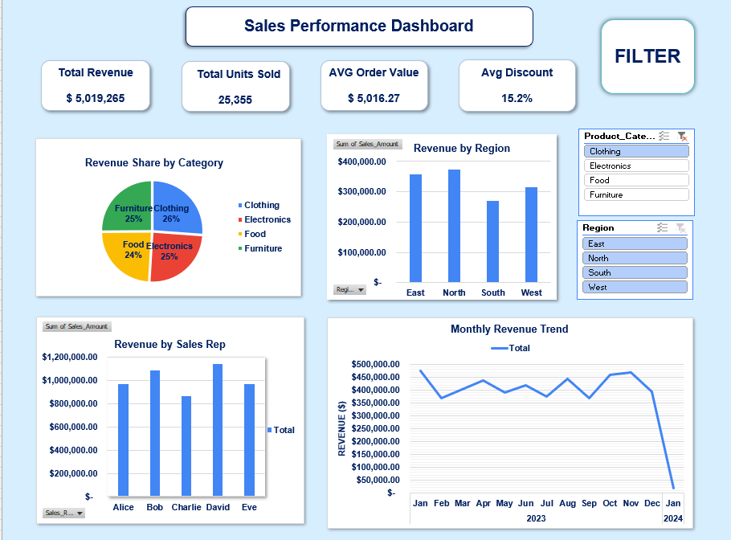

# Sales Dashboard (Excel)

## Overview
Interactive sales dashboard built in Excel as part of the Advanced Data Analysis course at NTI.

## Dataset
`sales_data.csv`: raw sales data used to build the dashboard.

## Dashboard Features
- Dashboard title and KPI totals
- Slicer for filtering the data
- Interactive charts
- Navigation button

## Tools
Microsoft Excel (Pivot Tables, Pivot Charts, Slicers)

## Dashboard Preview

